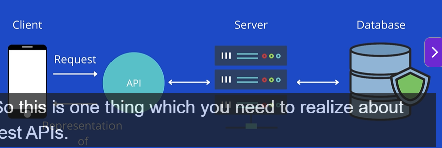

## API

An **API** (Application Programming Interface) is code that allows two programs to communicate with each other.

- A developer can write a program that communicates with an API.

## RESTful API

- A **RESTful API** is an API that uses HTTP requests to `GET`, `PUT`, `POST` and `DELETE` data.
- **REST** stands for **RE**presentational **S**tate **T**ransfer.
- REST is an architectural style for developing web services.



## HTTP Methods

| Method   | Purpose                                         | In short    |
| -------- | ----------------------------------------------- | ----------- |
| `GET`    | Retrieve a resource representation              | Get data    |
| `POST`   | Create a new resource                           | Post data   |
| `PUT`    | Update an existing resource                     | Edit data   |
| `DELETE` | Delete a resource                               | Delete data |

# FastAPI Setup (Mac)

Requires Python 3.6+.

```bash
# 1. Create a virtual environment named "env"
python3 -m venv env

# 2. Activate it
cd env
source bin/activate
cd ..

# 3. Install FastAPI
pip install "fastapi[standard]"
```

# Module 2: Path & Query Parameters

This module covers the two main ways a client sends values to an API through the URL:

- **Path parameters**: values that are part of the URL path itself, e.g. `/property/5`
- **Query parameters**: optional key/value pairs after a `?`, e.g. `/products?id=10&price=40`

FastAPI reads both straight from the function's parameters. The **type hints** tell it how to convert and validate the values.

## Path Parameters

Use `{name}` in the route, then add a function parameter with the same name.

```python
@app.get('/property/{id}')
def property(id: int):
    return f"This is a property page for property {id}"
```

| Request           | Result                                                    |
| ----------------- | --------------------------------------------------------- |
| `/property/5`     | `id = 5` (converted to an `int`)                          |
| `/property/abc`   | **422 error**: FastAPI rejects it because it's not an int |

- Without a type hint, the value arrives as a **string**.
- One dynamic route (`/property/{id}`) replaces writing a separate route for every item (`/property/1`, `/property/2`, …).

## Route Order Matters

FastAPI checks routes **top to bottom** and uses the first match.

```python
@app.get('/user/admin')          # fixed route: must come first
def admin():
    return "This is the admin panel"

@app.get('/user/{user_name}')    # dynamic route: catches everything else
def user(user_name: str):
    return f"This is a user page for user {user_name}"
```

If `/user/{user_name}` came first, a request to `/user/admin` would match it with `user_name = "admin"`, and the admin route would never run.

**Rule:** put fixed paths before dynamic ones whenever they could clash.

## Query Parameters

Any function parameter that is **not** in the path is treated as a query parameter.

```python
# /products?id=10&price=40
@app.get('/products')
def products(id: int, price: int):
    return f"Product {id}, price is {price}"
```

### Required vs Optional

| Definition             | Behaviour                                          |
| ---------------------- | -------------------------------------------------- |
| `id: int`              | **Required**: a missing value gives a **422 error** |
| `id: int = None`       | **Optional**: a missing value becomes `None`      |
| `limit: int = 10`      | **Optional with a default**: missing means `10`   |

Query parameters are **required by default**. Give them a default value to make them optional.

## Path + Query Together

You can combine both in one route. FastAPI works out which is which on its own:

```python
# /profile/10/comments?commentid=2
@app.get('/profile/{user_id}/comments')
def profile(user_id: int, commentid: int):
    return f"Profile page for user {user_id}, comment {commentid}"
```

- `user_id` is in the path, so it's a **path parameter**.
- `commentid` isn't, so it's a **query parameter**.

## Key Takeaways

- Path parameters identify **which** resource you want (`/property/5`).
- Query parameters **filter or modify** the request (`?price=40`).
- Type hints give you automatic conversion and validation (422 on bad input).
- Query parameters are required unless you give them a default.
- Route order matters: fixed routes go before dynamic ones.
- Try every route in the interactive docs at `http://127.0.0.1:8000/docs`.

# Things to Come Back To

- [ ] Introduction to FastAPI: why it's used now
